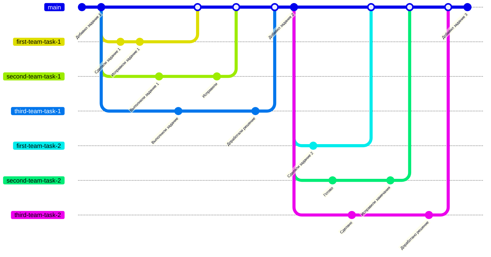
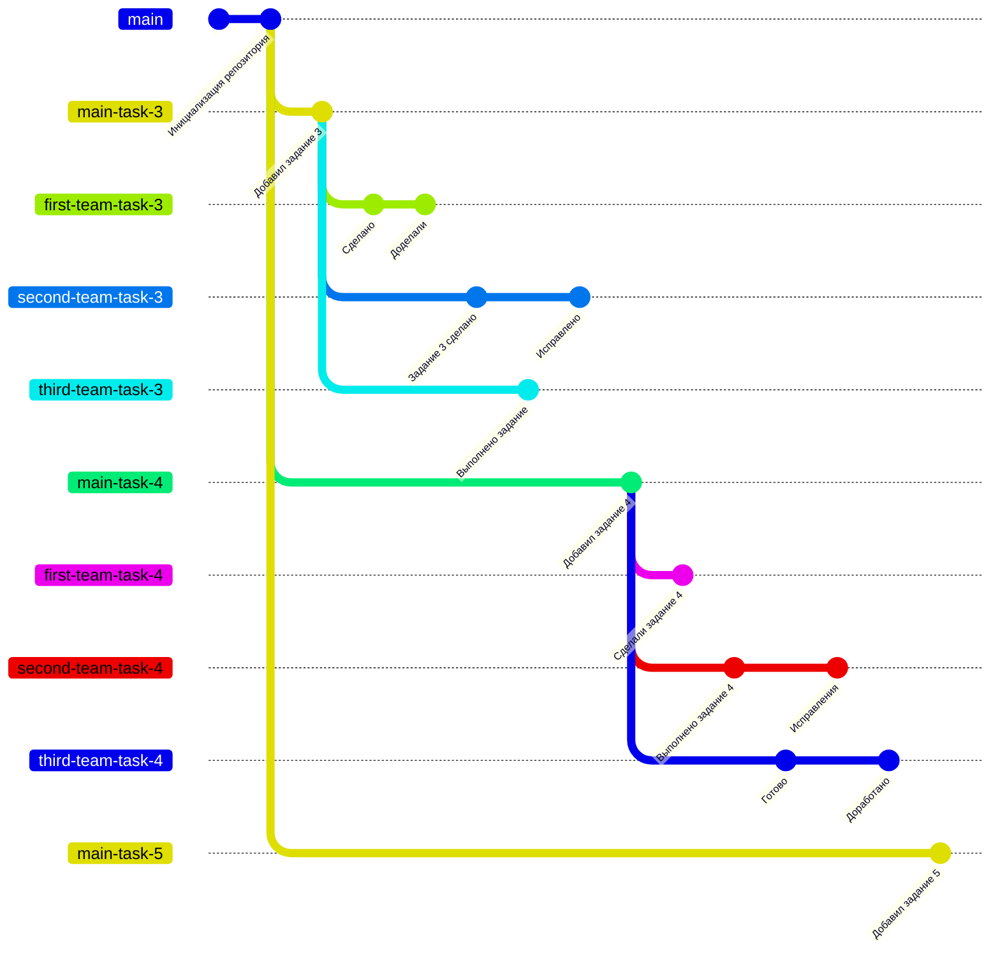

# Структура ветвления репозиториев курса

В курсе два репозитория с заданиями, и правила ветвления в них **разные**. Ниже — схема для каждого.

| Репозиторий | Где лежат задания | Ветка команды | base для pull request | После ревью |
|---|---|---|---|---|
| [manual-tasks](https://github.com/hse-algo-ris-25-1/manual-tasks) | каталоги `Задание N` в `main` | `<команда>-task-N` от `main` | `main` | **вливают** в `main` |
| [code-tasks](https://github.com/hse-algo-ris-25-1/code-tasks) | ветки `main-task-N` (защищены) | `<команда>-task-N` от ветки задания | ветка задания `main-task-N` | **закрывают без слияния** |

---

## Структура ветвления репозитория с ручными заданиями

Задания размещаются в основной ветке с названием `main`. Для выполнения задания команда студентов создаёт отдельную ветку на основе ветки `main`. В отдельной ветке, например `alpha-task-1`, студенты добавляют решение задания и создают запрос на внесение изменений с решением в ветку `main`. Преподаватель проверяет открытые запросы, при наличии замечаний оставляет комментарии к запросу, а при отсутствии замечаний одобряет запрос и вливает предложенные изменения в основную ветку. В результате все задания и все решения находятся в основной ветке `main`.

---

## Структура ветвления репозитория с программными заданиями

В основной ветке репозитория с названием `main` размещена общая информация о выполнении заданий по программированию. Сами задания размещаются в отдельных ветках с префиксом `main` в названии, например `main-task-3`. **Ветки с префиксом `main` защищены**: студенты не могут вносить изменения непосредственно в этих ветках. Для выполнения задания команда студентов создаёт отдельную ветку на основе ветки с решаемым заданием, например `main-task-3`. В этой ветке, например `alpha-task-3`, студенты добавляют решение задания и создают запрос на внесение изменений с решением в ветку **с решаемым заданием**. При открытии запроса на внесение изменений выполняются автотесты, проверяющие программный код, написанный студентами. Информация о прохождении тестов автоматически добавляется к запросу. Преподаватель проверяет открытые запросы, при наличии замечаний оставляет комментарии к запросу, а при отсутствии замечаний принимает выполненное задание и закрывает запрос без вливания предложенных изменений в ветку. В результате все задания и решения расположены в отдельных ветках.

---

## Правила именования веток

| Что | Шаблон | Пример |
|---|---|---|
| Ветка программного задания | `main-task-<N>` или `main-task-<N>-v<вариант>` | `main-task-2-v1` |
| Ветка команды (программное задание) | `<команда>-task-<N>[-v<вариант>]` | `first-team-task-3-v11` |
| Ветка команды (ручное задание) | `<команда>-task-<N>` | `first-team-task-3` |

Название команды пишется **строчными латинскими буквами, без пробелов**: одинаковый регистр во всех ветках нужен, чтобы по префиксу ветки можно было автоматически собрать статистику по команде. Список команд семестра фиксирован — см. таблицу команд на главной странице организации.
