# Установка необходимого ПО

> Скриншоты ниже сделаны в VS Code и на GitHub. На них может быть видна другая организация того же курса — у вас вместо неё будет `hse-algo-ris-25-1`, набор репозиториев и веток совпадает.

## GitHub account

Создать учётную запись на сервисе GitHub и отправить её преподавателю для добавления в GitHub-организацию для выполнения заданий курса.

## Git

Установить Git, если он ещё не установлен. Установщик для Windows можно скачать с официального сайта https://git-scm.com/downloads/win

## Python 3.14

Установить Python в версии 3.14, если он ещё не установлен. Если установлен Python в другой версии — установите дополнительно 3.14, они не конфликтуют. Установщик для Windows: [python-3.14.10-amd64.exe](https://www.python.org/ftp/python/3.14.10/python-3.14.10-amd64.exe) (подойдёт любая версия 3.14.x, актуальный список — на https://www.python.org/downloads/).

**Важно!** При установке необходимо добавить путь до Python в переменные окружения.

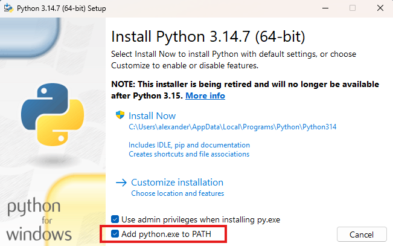

Проверьте, что установщик сработал: в **новом** терминале выполните `py -3.14 --version`. Должна появиться строка с версией 3.14.x. Если команда не находится — Python не добавлен в PATH, установку нужно повторить с соответствующей галочкой.

## VS Code

**Установить IDE Visual Studio Code**, если она ещё не установлена: https://code.visualstudio.com/Download

**Установить расширения** для VS Code, рекомендуемый набор:

- Python — https://marketplace.visualstudio.com/items?itemName=ms-python.python
- Pylance — https://marketplace.visualstudio.com/items?itemName=ms-python.vscode-pylance
- Python Debugger — https://marketplace.visualstudio.com/items?itemName=ms-python.debugpy
- GitLens — https://marketplace.visualstudio.com/items?itemName=eamodio.gitlens
- Code Spell Checker — https://marketplace.visualstudio.com/items?itemName=streetsidesoftware.code-spell-checker
- Russian — Code Spell Checker — https://marketplace.visualstudio.com/items?itemName=streetsidesoftware.code-spell-checker-russian
- Markdown Preview Github Styling — https://marketplace.visualstudio.com/items?itemName=bierner.markdown-preview-github-styles
- Markdown Preview Mermaid Support — https://marketplace.visualstudio.com/items?itemName=bierner.markdown-mermaid

Расширение Mermaid нужно для ручных заданий: диаграммы Ганта, сети, графы зависимостей. Без него превью в VS Code не покажет такие схемы.

Не забудьте включить расширение проверки орфографии для русского языка:

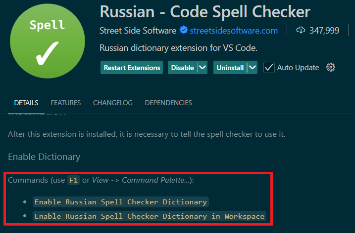

## Клонирование репозиториев

**Клонировать репозиторий** с заданиями, предварительно авторизовавшись на GitHub.

Для **программных** заданий клонируйте репозиторий [code-tasks](https://github.com/hse-algo-ris-25-1/code-tasks): в нём дальше создаёте `.venv` и ставите зависимости.

Для **ручных** заданий клонируйте [manual-tasks](https://github.com/hse-algo-ris-25-1/manual-tasks): Python-окружение не нужно, достаточно VS Code.

В VS Code: **Welcome → Clone Git Repository** (или `Ctrl + Shift + P` → `Git: Clone`).

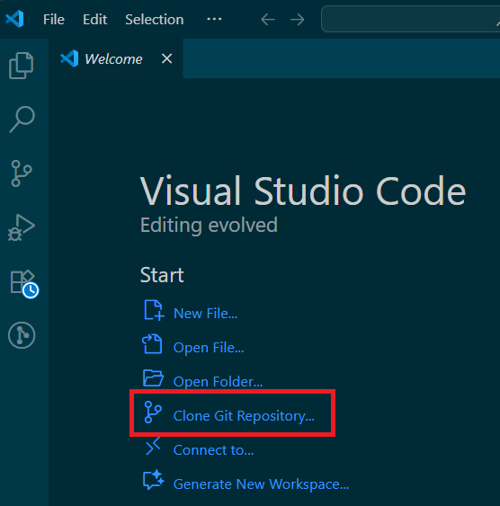

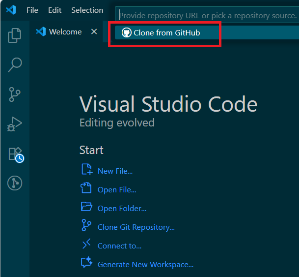

После авторизации репозитории организации будут доступны для выбора и клонирования. Введите в строку поиска `hse-algo-ris-25-1` — увидите `code-tasks`, `manual-tasks` и `docs`:

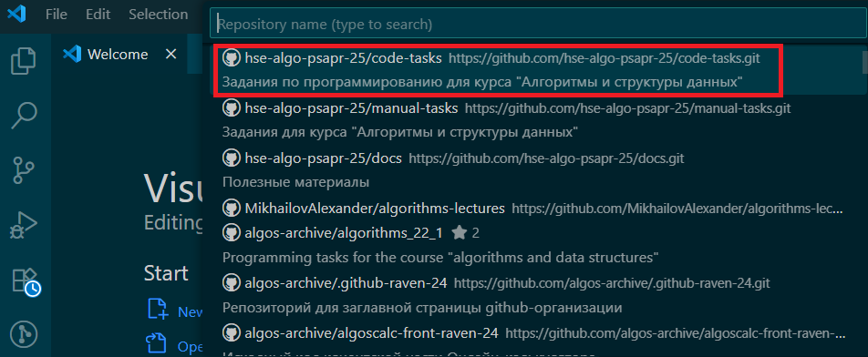

То же самое можно сделать в терминале:

```sh
git clone https://github.com/hse-algo-ris-25-1/code-tasks.git
git clone https://github.com/hse-algo-ris-25-1/manual-tasks.git
```

## Терминал в VS Code

Открыть терминал: `Ctrl + ~` (или меню **Terminal → New Terminal**). Все команды из инструкций выполняются в терминале VS Code, в каталоге склонированного репозитория.

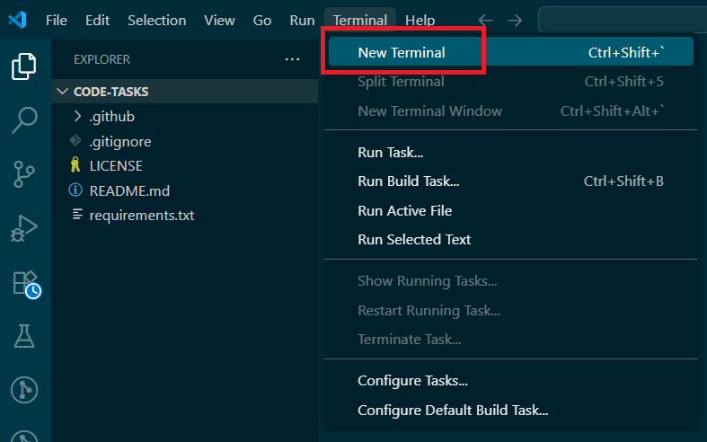

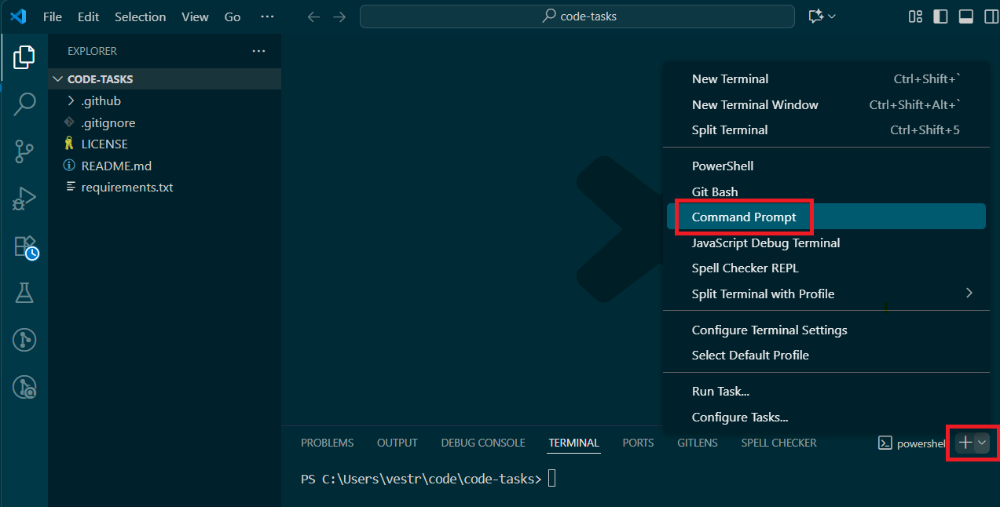

Проверить, что терминал открыт в нужном каталоге и что Git видит репозиторий:

```sh
pwd
git status
```

## Виртуальное окружение и зависимости (только для программных заданий)

Выполняется в каталоге `code-tasks`. Смысл шага — изолировать проект от других ваших Python-проектов, чтобы версии библиотек не конфликтовали. В `manual-tasks` этот шаг пропускают.

Создать окружение:

```sh
py -3.14 -m venv .venv
```

Активировать — команда зависит от терминала:

| Терминал | Команда активации |
|---|---|
| Командная строка (cmd) | `.venv\Scripts\activate.bat` |
| PowerShell | `.\.venv\Scripts\Activate.ps1` |
| Git Bash | `source .venv/Scripts/activate` |

В PowerShell запуск скрипта может быть заблокирован. Тогда один раз разрешите его для текущего пользователя:

```powershell
Set-ExecutionPolicy -Scope CurrentUser -ExecutionPolicy RemoteSigned
```

Признак того, что окружение активно, — префикс `(.venv)` в начале строки терминала:

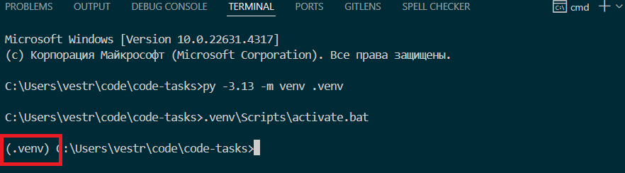

После создания окружения IDE предложит использовать его по умолчанию — подтвердите. Вручную интерпретатор выбирается командой `Ctrl + Shift + P` → **Python: Select Interpreter**.

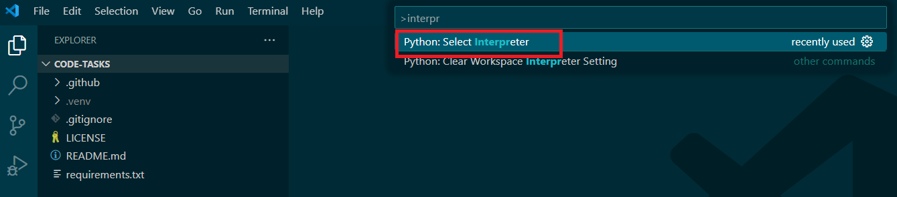

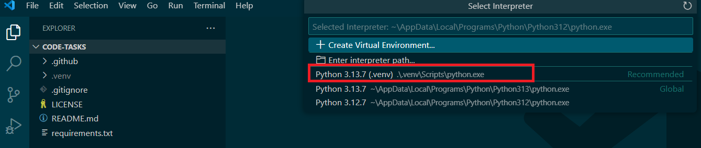

Если в редакторе открыт файл Python, в правом нижнем углу должен быть выбран интерпретатор из `.venv`:

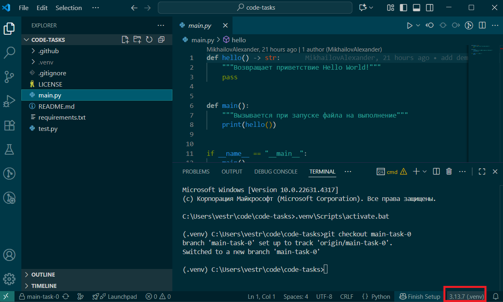

Установить зависимости. Команду `pip install -r requirements.txt` выполняйте **только** в терминале, где есть префикс `(.venv)`. Открыли новое окно терминала — сначала снова активируйте окружение, иначе пакеты попадут в системный Python:

```sh
pip install -r requirements.txt
```

Проверить, что интерпретатор правильный:

```sh
python --version
```

Должна появиться версия 3.14.x.

## Проверка оформления и тестов

`ruff` уже входит в `requirements.txt`, а `unittest` — часть стандартной библиотеки Python. Отдельно ставить их не нужно.

```sh
ruff check .
ruff format .
python -m unittest discover -s . -p "test*.py" -v
```

## Если не Windows

Команды отличаются только активацией окружения:

- macOS / Linux: `python3.14 -m venv .venv`, затем `source .venv/bin/activate`
- Путь к интерпретатору: `.venv/bin/python` вместо `.venv\Scripts\python`

Всё остальное (`git`, `ruff`, `unittest`) совпадает. Скриншоты и команды выше — для Windows.

## Частые проблемы

| Симптом | Причина и решение |
|---|---|
| `python: command not found` / открывается Microsoft Store | Python не в PATH. Переустановите с галочкой «Add python.exe to PATH», откройте **новый** терминал |
| В терминале нет `(.venv)` | Окружение не активировано — повторите активацию, команды `pip` установят пакеты в системный Python |
| `source: command not found` или `.venv\Scripts\activate: No such file` | Команда активации не соответствует терминалу — см. таблицу выше |
| `ModuleNotFoundError: No module named 'matplotlib'` (и аналоги) | Зависимости не установлены или установлены не в то окружение: активируйте `.venv` и повторите `pip install -r requirements.txt` |
| `git: command not found` | Git не установлен или не в PATH, перезапустите VS Code после установки |
| `Permission denied (publickey)` при `git push` | Не настроена авторизация: используйте вход через браузер (Git Credential Manager) или SSH-ключ |
| VS Code не видит тесты на вкладке Testing | Не выбран фреймворк `unittest` или корень проекта — см. инструкцию по выполнению задания |
| `ruff: command not found` | Окружение не активировано либо зависимости не установлены |
| В ветке нет `main.py` и `test.py` | Ветка создана не от ветки задания — см. раздел «Нет файлов задания» в [инструкции по выполнению](submitting-code-task.md) |
