# Задания по программированию

Задания предполагают реализацию на языке Python 3.14. Для выполнения заданий рекомендуется использовать IDE Visual Studio Code.

Задания размещены в отдельных ветках репозитория [code-tasks](https://github.com/hse-algo-ris-25-1/code-tasks), название которых начинается с префикса `main`, например ветка `main-task-1`. Если у задания несколько вариантов, в названии ветки есть суффикс варианта: `main-task-2-v1`, `main-task-2-v2`, `main-task-2-v3`.

В файле `README.md` **в ветке задания** расположена информация, необходимая для его выполнения.

> Скриншоты ниже сделаны в VS Code и на GitHub. На них может быть видна другая организация того же курса — у вас вместо неё будет `hse-algo-ris-25-1`; названия репозиториев и веток совпадают.

## С чего начать

Перед выполнением первого задания настройте рабочее место согласно инструкции [Установка необходимого ПО](installing-software.md): учётная запись GitHub, Git, Python 3.14, VS Code и клонирование репозитория с программными заданиями.

В клонированном репозитории создайте виртуальное окружение (каталог `.venv`) и установите зависимости командой `pip install -r requirements.txt`. Решения в основную ветку `main` не коммитят — только в отдельную ветку задания. Каталог `.venv` в репозиторий добавлять не нужно.

## Почему в ветке `main` нет файлов задания

В `main` лежат только инфраструктура и правила: `README.md`, `requirements.txt`, `ruff.toml`, каталог `.github`. **Файлов задания (`main.py`, `test.py`) там нет и быть не должно** — каждое задание живёт в своей ветке. Это самая частая точка спотыкания: репозиторий склонирован правильно, а файлов задания не видно.

Поэтому перед работой нужно получить с сервера ветку задания и создать от неё свою.

## Выполнение заданий

**Для выполнения конкретного задания необходимо создать отдельную ветку** на основе ветки с заданием: назвать новую ветку так же, как ветку задания, заменив префикс `main` на название команды, например `first-team-task-1` (если у задания есть вариант, суффикс сохраняется: `first-team-task-2-v1`).

Сначала получить с сервера ветки, которых у вас локально может ещё не быть:

```sh
git fetch origin
```

То же самое можно сделать через вкладку Source Control на боковой панели IDE: **`…` → Pull, Push → Fetch**.

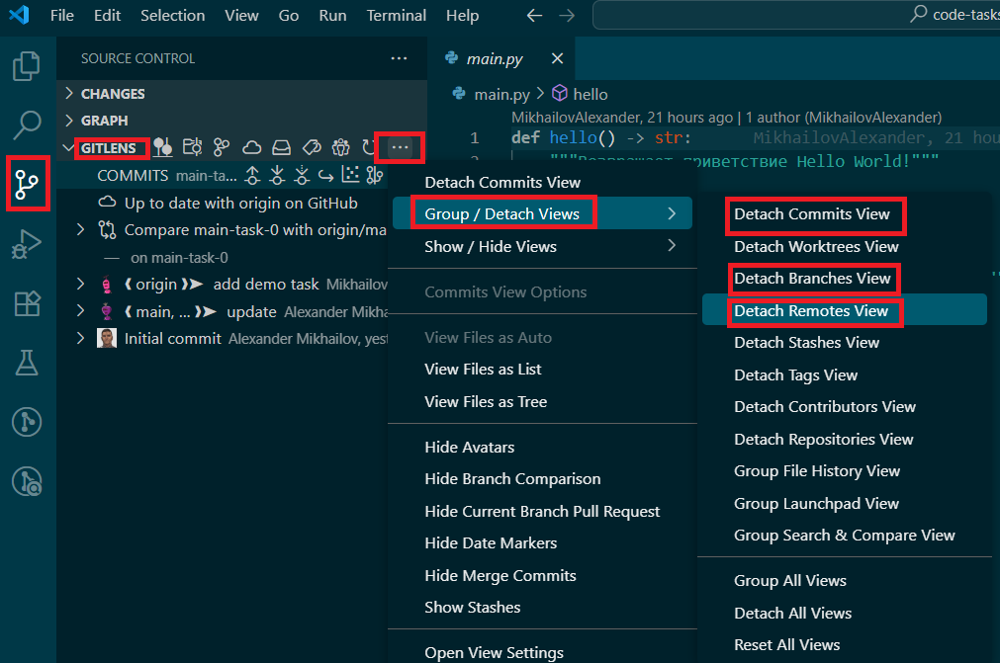

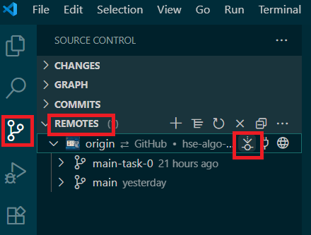

Затем создать свою ветку **от ветки задания**:

```sh
git switch --create first-team-task-1 origin/main-task-1
```

В VS Code то же действие: внизу слева нажать на название ветки → **Create new branch…** и выбрать в качестве источника `origin/main-task-1`, а не `main`.

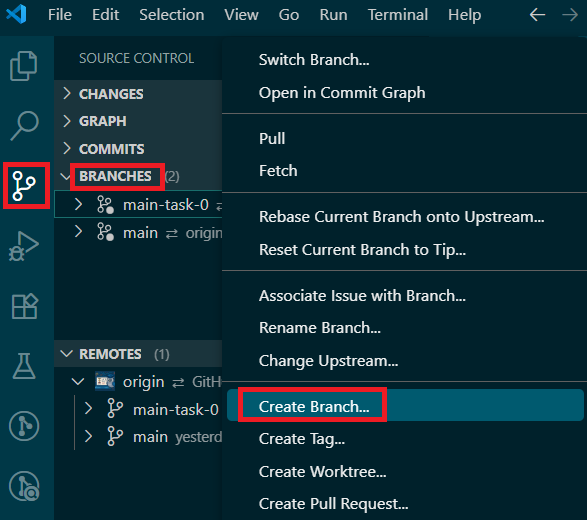

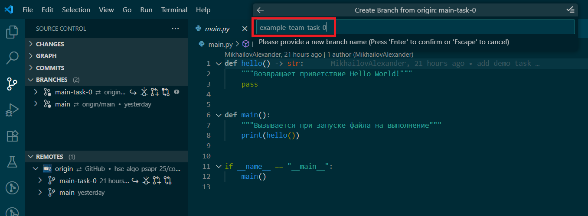

Проверить, что вы в нужной ветке и что файлы задания появились:

```sh
git branch --show-current
ls
```

В названии ветки должно быть имя вашей команды, в списке файлов — `main.py` и `test.py`. В VS Code текущая ветка показана в левом нижнем углу окна.

### Нет файлов задания — что проверить

| Симптом | Причина | Решение |
|---|---|---|
| Ветка ваша (`first-team-task-1`), но нет `main.py` | Ветка создана от `main`, а не от ветки задания | `git switch --create first-team-task-1 origin/main-task-1` — заново, от `origin/main-task-1` |
| `git switch main-task-1` → `invalid reference` | Ветка задания ещё не подтянута | `git fetch origin`, затем повторить |
| Ветку видно на GitHub, но не локально | Клонировали раньше, чем появилась ветка | `git fetch origin` |
| Скачали ZIP с главной страницы репозитория | Кнопка **Code → Download ZIP** отдаёт только `main` | Скачивать архив нужной ветки: `https://github.com/hse-algo-ris-25-1/code-tasks/archive/refs/heads/main-task-1.zip` |
| Файлы были и пропали | Переключились на другую ветку | `git switch --create …` или `git switch <ваша ветка>`, файлы вернутся |

## Что делать в ветке задания

Как правило, нужно реализовать предложенные функции в файле `main.py`. Модульные тесты лежат в файлах, имя которых начинается с `test` — в первом задании это `test.py`. Если функций несколько и тесты разложены по файлам (`test_fibonacci.py`, `test_determinant.py`), есть два способа запуска: выполнить нужный файл напрямую или запустить сразу все тесты в каталоге командой `python -m unittest discover -s . -p "test*.py"` — именно эту команду использует автоматическая проверка.

Рекомендуется настроить тесты на вкладке Testing левой панели:

1. Нажать **Configure Python Tests** и выбрать фреймворк `unittest`.

   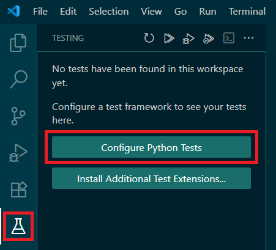

   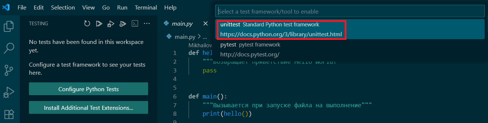

2. В качестве корневой директории проекта выбрать корень репозитория.

   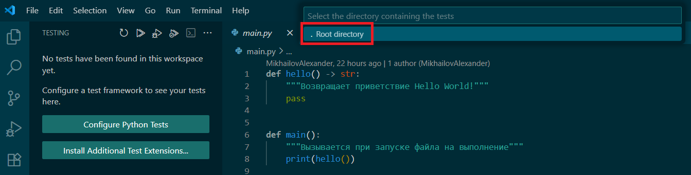

3. Шаблон имени файла для поиска тестов — `*test*.py`. Автоматическая проверка ищет файлы с именем на `test`; если назвать файл `my_test.py`, тесты в нём запущены не будут.

   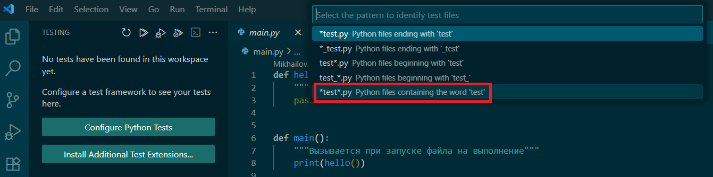

4. Перезагрузить IDE.

   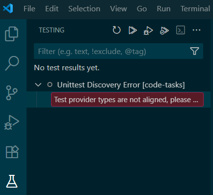

После этого тесты доступны для просмотра и запуска в боковой панели:

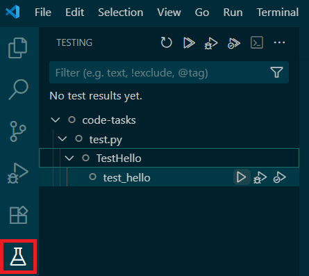

## Проверка оформления перед сдачей

После выполнения задания и прохождения тестов выполните в терминале с активным `(.venv)`:

```sh
ruff check . --fix
ruff format .
ruff check .
python -m unittest discover -s . -p "test*.py" -v
```

Последняя команда `ruff check .` должна завершиться без ошибок. На вкладке Checks в pull request стиль **не валит** сборку: там `ruff` останавливает проверку только на синтаксических ошибках и неопределённых именах, замечания по стилю идут с `--exit-zero`. Зелёные Checks не означают, что оформление принято — на ревью смотрят и стиль. Приведите код к виду, который проходит локальный `ruff check .` без замечаний.

## Результат выполнения задания — pull request

После реализации предложенных функций, прохождения всех модульных тестов, проверки синтаксиса и оформления кода необходимо зафиксировать изменения (`git commit`) и отправить их в репозиторий на GitHub (`git push`). Это можно сделать на вкладке Source Control, добавив через `+` нужный файл и написав сообщение коммита.

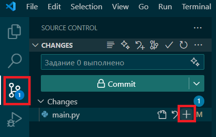

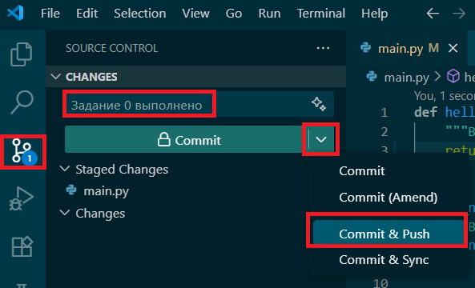

При первом коммите Git может попросить заполнить данные пользователя в конфигурации:

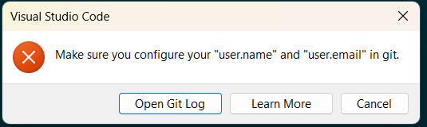

Можно задать имя и почту глобально:

```sh
git config --global user.email "you@example.com"
git config --global user.name "Your Name"
```

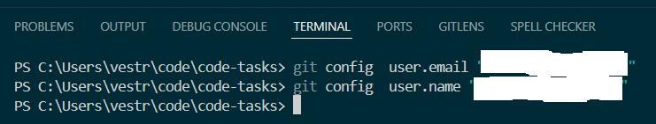

или локально, только для текущего репозитория, убрав из команд опцию `--global`. Эти данные используются в метаданных коммитов.

То же самое в терминале:

```sh
git add .
git commit -m "Задание 1: реализована функция ..."
git push --set-upstream origin first-team-task-1
```

Опция `--set-upstream` (`-u`) нужна при первой отправке новой ветки: без неё `git push` может сообщить, что имя вашей ветки не совпадает с именем ветки, за которой она закреплена. Если текущей ветки нет на сервере, VS Code выведет соответствующее предупреждение — нужно согласиться.

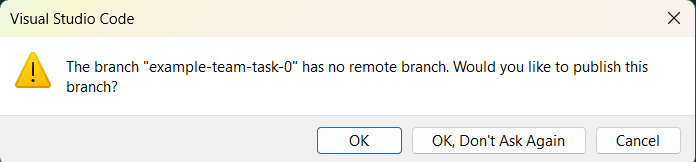

После фиксации и отправки изменений необходимо создать на GitHub pull request (запрос на включение изменений) **в ветку задания**, не в `main`. На GitHub это называется merge / «слияние», но в этом репозитории предложенный код **не вливают** в `main-task-*`: ветки заданий защищены, после ревью преподавателем и выставления оценки запрос закрывается без вливания (merge). Решение остаётся в ветке команды.

Важно не ошибиться с выбором веток для запроса: в **base** указать ветку задания, например `main-task-1` (для варианта — `main-task-2-v1`), а в **compare** — собственную ветку с выполненным заданием, например `first-team-task-1`. В заголовке запроса можно указать название своей ветки — так удобнее искать запрос в списке. В описании запроса можно указать роли участников команды, выполнявших задание, или добавить информацию, если это явно указано в задании.

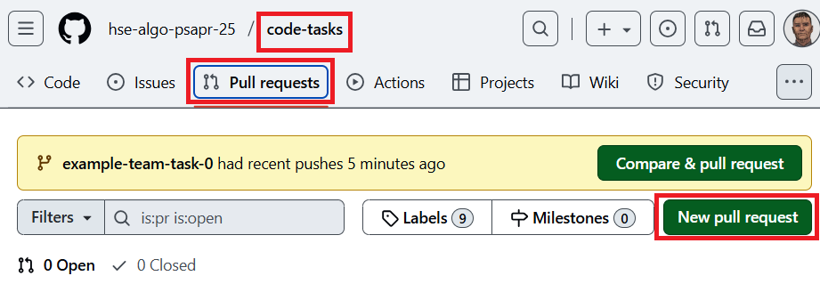

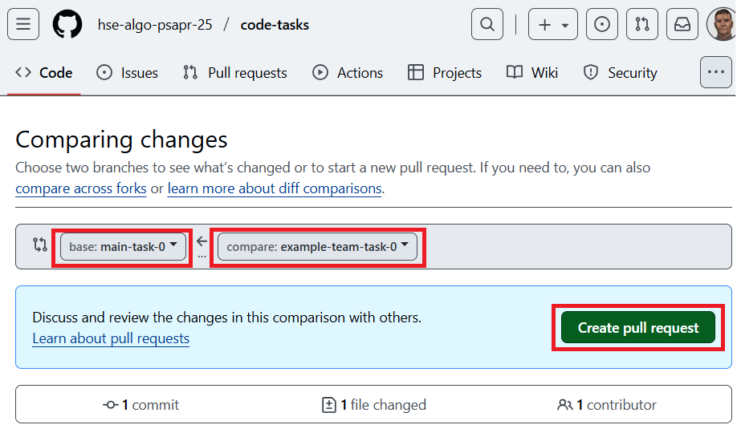

После создания pull request автоматически запускаются тесты: ход выполнения и результаты — на вкладке **Checks**.

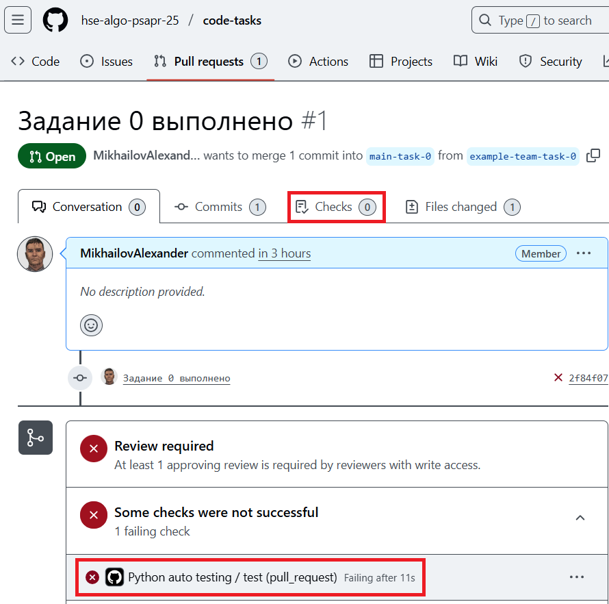

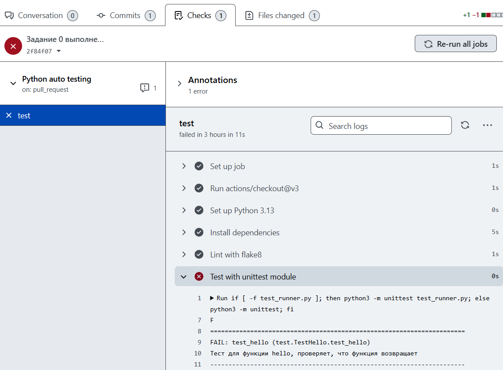

Если выполнение тестов выявило ошибки, следует исправить их, снова зафиксировать и отправить изменения на GitHub: они автоматически появятся в том же pull request (**новый запрос создавать не нужно**). На вкладке **Files changed** видны изменения в файлах по сравнению с целевой веткой. На вкладке **Conversation** ведётся обсуждение выполненного задания.

Если автоматическое тестирование не выявило ошибок, преподаватель проведёт ревью кода и подтвердит его либо оставит вопросы или замечания. Зелёные Checks сами по себе не закрывают задание: ревью смотрит реализацию и оформление. После подтверждения задание будет оценено, pull request **будет закрыт без слияния** с веткой `main-task-*`.

## Если Check красный из-за ветки base

Типичная ошибка — pull request открыт в `main`. Проверка напишет об этом в PR. Исправление: на странице PR нажмите **Edit** рядом с base, выберите нужную ветку `main-task-…` и сохраните. Новый pull request создавать не нужно, Checks перезапустятся.

## Защита задания

На защите нужно объяснить код и идеи, заложенные в его реализацию, а также ответить на вопросы по теме задания и материалам лекции. Программный код пишут и правят только участники команды: **генеративные модели и средства автодополнения кода** использовать для написания и редактирования кода нельзя.
